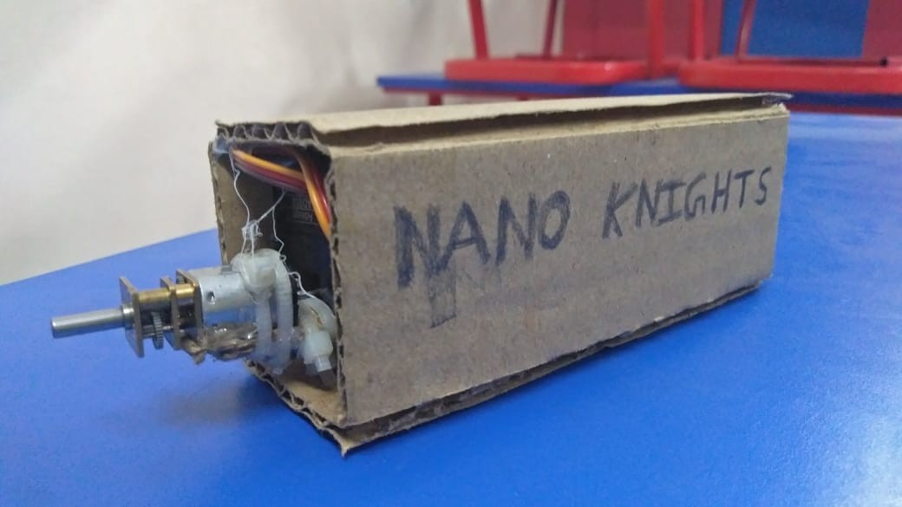
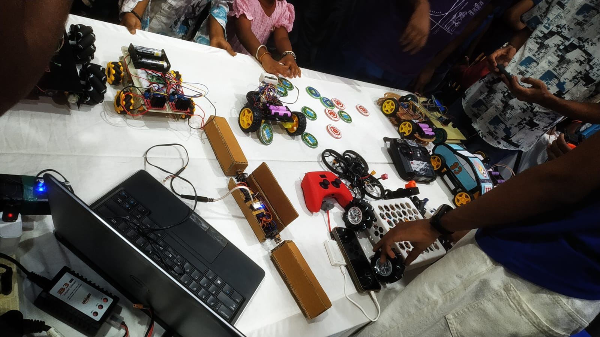

# UniBot

>**What is Unibot?**

Unibots are small wireless robots that work together to accomplish a task collectively. It is an example of Swarm Robotics.

**As each robot can independently reorient its drive assemblies, multiple UniBots can reconfigure their collective geometry and movement direction. This creates the possibility of using the same population of robots for different formations and tasks that a single robot cannot accomplish.**

UniBot is a continuing experiment rather than a finished project.

Inspired by the reconfigurable microbots in Disney's Big Hero 6.

For the engineering documentation and development process:

[Read the UniBot Project Report](UniBot_Project_Report.pdf)

## V1

[Watch the original V1 demonstration](Photos/README.md)

Each UniBot uses a two-axis articulated drive mechanism: an N20 geared motor provides propulsion while an AD002 servo rotates the drive assembly. This allows the robot to change its direction of travel and, when multiple robots operate together, creates the possibility of collective reconfiguration into different formations.

The current UniBot prototype demonstrates:

* Wireless communication over Wi-Fi
* two-axis articulated locomotion mechanism
* Python-based control software

The current prototype is extremely simple and stable. It serves as a foundation for experimenting with autonomous collective behavior.

The current prototype is only the first step.

The central question is:

> **How much collective capability can emerge from many extremely simple robots?**

### Recognition & Presentation

UniBot V1 was selected for presentation at **IIT Madras Shaastra 2026 through the School Connect program**

The project explores how multiple small robots with independently reorientable drive assemblies could change their collective movement and configuration.

*UniBot showcased at IIT Madras during the School Connect program.*

## The Idea

A single small robot has obvious limitations: Specific functionality, portability, scale, and physical capability.

but a team of multiple small robots change the situation entirely. 

If individual robots can communicate and coordinate, the swarm can:

* divide tasks between robots
* adapt when individual robots fail
* form different structure for different tasks
* share information
* operate using inexpensive hardware
* recharge autonomously and continue operating

**The goal is not to make one tiny robot extremely capable.
The goal is to make many simple robots capable of working together.**

## Hardware

The current prototype is built around:

* ESP8266
* N20 DC motors and AD002 Servos
* Custom miniature mechanical platform (Hot glue and cardboard ;))
* L293D and Custom Perf-Board cicuit

The architecture is intentionally designed around **low-cost and accessible components**, allowing multiple units to be constructed efficiently.

## Software

### Robot

* MicroPython
* ESP8266
* TCP/WebSocket communication

### Control System

* Python
* Socket networking
* Pynput

## Next Steps

The next generation focuses on moving beyond individual control toward **collective autonomy**:

1. Indoor Localization
2. Robot-to-robot communication
3. Autonomous navigation
4. Task allocation
5. Formation/collective movement
6. Autonomous docking
7. Fault-tolerant swarm behavior

## Team

**Knight Labs**

* Senthil Arasu J 
* Sahithian TR
* Muhammad Fayaazullah F

## Project Status

**Experimental / Research Prototype**

UniBot is an ongoing exploration of miniature distributed robotics. The current implementation demonstrates the basic platform; future versions will focus increasingly on autonomous coordination and collective behavior.
